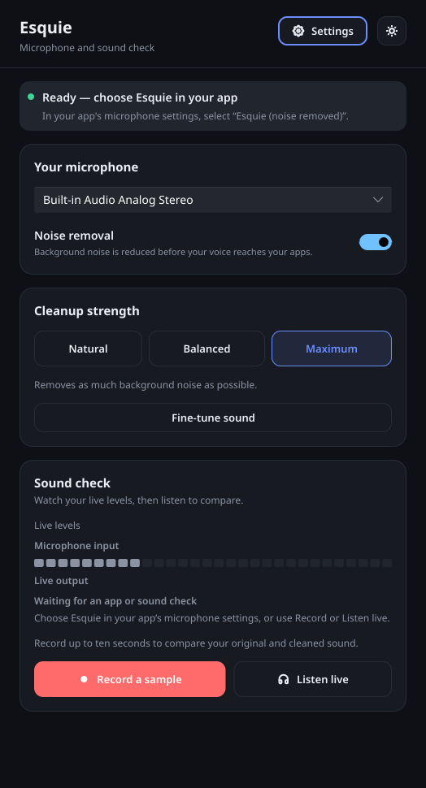

# Esquie

> Men Trip Not On Mountains; They Stumble Upon Stones.

Offline, real-time noise removal for your microphone on Linux.

Esquie reduces background noise before your voice reaches Discord, Zoom, OBS,
or other calling and recording apps. It creates a virtual microphone called
**Esquie (noise removed)** that you select in your app's audio settings.

Powered by [DeepFilterNet 3](https://github.com/Rikorose/DeepFilterNet), with the
model built in. Audio is processed locally and never leaves your machine. The
only network access is an optional daily update check against GitHub and, when
you choose to update, downloading the new release.

## Download

**[Download for Linux — AppImage](https://github.com/ShaderCompilation/Esquie/releases/latest)**

For **x86_64 Linux desktops** with **PipeWire 1.0+**, a session manager such as
WirePlumber, and **glibc 2.39+** (Ubuntu 24.04 baseline). Works with Wayland
and X11. Calling apps that use PulseAudio also need `pipewire-pulse`.
Standalone PulseAudio, ALSA-only, and JACK-only setups are not supported.

No Rust or development packages are needed. See the
[AppImage guide](docs/appimage.md#download-verify-and-run) for signature
verification and full requirements, or [FUSE help](docs/appimage.md#fuse-troubleshooting)
if the download will not open. Esquie can check for new releases and install
signed updates in place; versions 0.1.0 and 0.1.1 need one
[manual update](docs/appimage.md#updating).

*Choose your microphone and adjust cleanup in one window.*

## Get started

1. Download the AppImage and its `.sha256` and `.sha256.minisig` files from
   the release page. [Verify the signature and checksum](docs/appimage.md#download-verify-and-run), then allow
   the AppImage to run: in your file manager, open **Properties → Permissions**
   and enable execution (the wording varies by desktop), or run
   `chmod +x "Esquie-*-x86_64.AppImage"` with the downloaded filename.
2. Open the AppImage as your normal desktop user and choose your real microphone.
   The setup guide can help you check your sound.
3. In your calling or recording app, select **Esquie (noise removed)** as the
   microphone. Keep Esquie running while you use it.

You can add Esquie to your application menu or install a per-user copy from
**Settings → Installation and launchers**. See
[installation instructions](docs/appimage.md#adding-it-to-the-application-menu).

## Make it sound right

- **Choose your cleanup strength.** Natural, Balanced, and Maximum let you
  decide how much background sound to keep. Fine-tune sound offers a precise
  slider, extra cleanup, and quieter pauses.
- **Hear the difference.** Record up to ten seconds and switch between Original
  and Cleaned playback. You can also listen live; use headphones to avoid echo.
- **Keep it handy.** With a supported system tray, closing the window keeps
  Esquie running. Without a tray, closing quits. Start on login is available
  in Settings; some compositors need their own startup configuration.

## Help and documentation

- [Using Esquie](docs/usage.md) — controls, sound checks, tray, and start on login.
- [AppImage guide](docs/appimage.md) — installation, updates, and removal.
- [Troubleshooting](docs/troubleshooting.md) — startup, audio, and diagnostics.
- [Build from source](docs/building.md) — dependencies, builds, and checks.
- [Report a bug or request a feature](https://github.com/ShaderCompilation/Esquie/issues).

Compatibility depends on your desktop and audio setup. The configured CI matrix
covers Ubuntu and Arch Linux. I manually checked on Fedora GNOME, Fedora KDE, Ubuntu GNOME,
CachyOS COSMIC, and Linux Mint.
If you encounter a problem, include your Esquie version and setup, and describe
what you tried. If possible, export your logs from **Settings → Diagnostics**,
review them, and attach them to the report.

## Contributing

Bug reports, feature requests, and testing on different Linux desktops and
microphones are welcome. Read [CONTRIBUTING.md](CONTRIBUTING.md).
Before starting a code contribution, please open an issue to check that the
change fits the project's direction.

## License

Copyright © 2026 Hayk Sahakyan. Esquie's code, documentation, and artwork are
licensed under [GPL-3.0-only](LICENSE). Dependencies and the embedded model retain
their own licenses; see [third-party notices](THIRD_PARTY_NOTICES.md).
